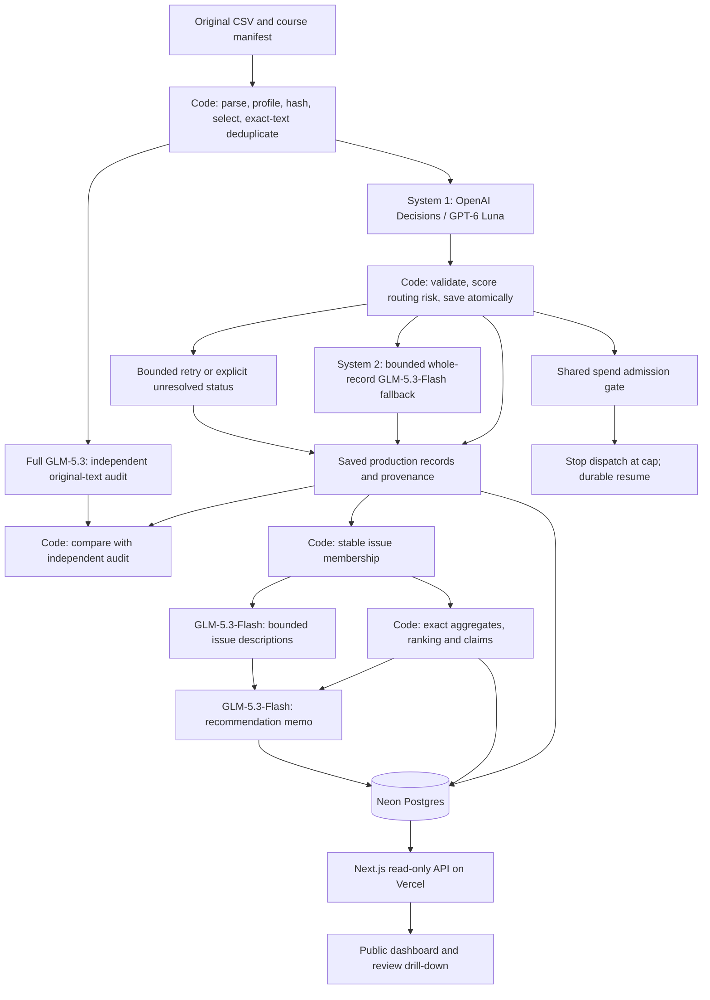

# Spotify reviews: an auditable product-priority pipeline

**Prioritize usability reliability and control clarity; validate specific library-recovery fixes through further investigation.** This pipeline turns historical Spotify app-store reviews into a product recommendation with saved classifications, independent verification, deterministic calculations, and review-level evidence.

- **Live dashboard:** [Spotify Review Observatory](https://spotify-review-observatory.vercel.app). Public and read-only; no login or paid model call is required to inspect results.
- **Final evidence:** [hero-v1 release](https://github.com/shahdevansh/spotify-review-pipeline/releases/tag/hero-v1), including the memo, grading export, cost calculator measurements, evaluation, and recovery evidence. ZIP SHA-256: `950fe1f6fcb1b53a3cc6ce634b071411669b930e5aba05f0c623ea871947049d`.
- **Publication receipt:** [final verification receipt](https://github.com/shahdevansh/spotify-review-pipeline/releases/download/hero-v1/publication-receipt.json), published separately from the ZIP, records its final checksum, code/documentation revisions, deployment identity and final QA timestamp.
- **Decision memo:** [AI-generated and factually reviewed recommendation](docs/hero-decision-memo.md). Material issue-level numbers cite claim IDs; recommendations cite issue and review IDs.
- **Final run:** `hero-v1`, configuration `spotify-f84b2a9afdaa455fd81d26077cab1ccebc7a62bb1b46bab461d9ae593bcb584a`. Verified pipeline code revision: `b354b75b95570e7485192011f5de89f0104c19de`; later documentation commits do not change the frozen inference configuration.

## Grader entry point and submission supplement

Start with [SUBMISSION.md](SUBMISSION.md) for the ten rubric criteria, current evidence links, exact completion limits and reproduction steps. The [submission supplement](https://github.com/shahdevansh/spotify-review-pipeline/releases/download/hero-v1/spotify-submission-supplement.zip) preserves the earlier partial [v2 human-reference comparison](evals/human-reference-v2/) and [fresh setup/replay/ranking validation](evals/submission-readiness/), including a fixed-input identity sidecar and separately reported frozen-model synthetic safety evidence. The current [v3 expected-label/prediction comparison](evals/human-reference-v3/) and [course-reference v3 ZIP](https://github.com/shahdevansh/spotify-review-pipeline/releases/download/hero-v1/spotify-course-reference-v3.zip) add the completed golden-50 reference after AI-assisted drafting and explicit human review. The original hero ZIP, earlier supplement, historical references and production predictions remain unchanged. Use the [explicit hero calculator guide](cost/hero-replay.md); older generic CLI defaults describe an earlier experiment.

## Results and scope

The completed reference and dashboard update were verified on October 21, 2026. The [publication receipt](evals/submission-readiness/course-reference-v3/receipt.json), [rendered dashboard](evals/submission-readiness/course-reference-v3/dashboard.png), and [production build log](evals/submission-readiness/course-reference-v3/vercel-build.log) document the immutable v3 report link, complete golden-field coverage, anonymous API checks, 18 offline import/export tests, and 39 web tests. This update made no model calls or database writes.

The complete source was ingested and profiled. Classification covers a reproducible **200,000-review subset**, plus all 13 empty source texts as explicit quarantines. This follows the amended assignment allowance of at least 100,000 reviews. It is not a classification of all 660,609 nonempty source reviews.

| Measure | Final result | Evidence (ZIP paths unless linked) |
|---|---:|---|
| Full source rows / nonempty / empty | 660,622 / 660,609 / 13 | `grading/ingestion.json` |
| Selected nonempty reviews / exact distinct texts | 200,000 / 152,363 | `selection.json` |
| Completed / quarantined / unresolved selected rows | 200,000 / 13 / 0 | `grading/run.json`, `grading/records.jsonl.gz` |
| Actual direct exact-text cache aliases | 47,637 | `grading/records.jsonl.gz` |
| Independent full GLM-5.3 audit | 40,000 / 40,000 selected IDs; zero unresolved comparisons | `evals/hero/evaluation.json` |
| Audit topic / intent / severity agreement | 36,187/40,000 (90.4675%) / 37,220/40,000 (93.0500%) / 36,341/40,000 (90.8525%) | `evals/hero/evaluation.json` |
| Golden AI-assisted, human-confirmed topic / intent agreement | 36/50 (72.00%) / 44/50 (88.00%) | [v3 report](evals/human-reference-v3/report.md) |
| Golden reference topic / intent / severity / sentiment coverage | 50 of 50 for each required field | [v3 validation](evals/human-reference-v3/validation.json) |
| Project-wide recorded token-rate spend / unresolved charge hold | $35.319959027 / $1.563189415 | `run/run_summary.json` → `global_spending` |
| Recorded hero workflow through first public release, including checkpoints and recovery | approximately 4 h 10 min through the first public release (14,986.278 s); final documentation/release-refresh QA is separate | `operational-final.json` |
| Course checker / hosted API reconciliation | `review_required`: 48 failed requests lack usage; all other checks pass / pass: all saved issue members and 19 detail samples reconciled | `checker.json`, `checker-acceptance.json`, `publication-reconciliation.json` |

The 40,000-review audit reports **model agreement, not human accuracy**. The verifier receives original text and the rubric without production predictions or confidence scores. Its GLM model family is also used for fallback, so correlated mistakes remain possible. Failed comparisons remain in the denominator. There were **8,565 categorical disagreements**: at least one of topic, intent or severity differed. Separately, 14,175 records had an absolute sentiment difference above 0.25; 4,169 also had a categorical disagreement. Their union is 18,571 records, including 10,006 with only the sentiment-threshold disagreement. These are different definitions, not duplicate counts. The [final business and trace audit](evals/hero/business-audit.md) reconciles both counters.

Topic and intent point estimates exceed the requested 90% and 93% thresholds, respectively. The reported 95% Wilson intervals are 90.1758–90.7514% for topic, 92.7966–93.2951% for intent, and 90.5660–91.1311% for severity. **Intent's interval crosses 93%; this does not establish population agreement above that threshold with 95% confidence.** These binomial intervals also do not eliminate uncertainty from repeated texts or correlated model errors.

**Complete structural coverage does not mean semantic uncertainty is resolved.** An independent arithmetic precheck of all 200,013 selected records found 200,000 valid completed classifications, 13 quarantines, no foreign IDs or source-hash mismatches, and 47,637 direct exact-text aliases. Nevertheless, **51,293/200,000 records (25.6465%) retain `needs_review`**. Whole-record fallback covered 22,854/152,363 distinct texts (14.9997%), represented by 24,990 original review IDs. The fallback cap limited model escalation; it did not clear every review flag. One complaint labeled severity 1 remains a flagged rubric-consistency warning even though its schema is valid. These records remain visible in the saved result and business aggregates.

The saved baseline contains 87,897 complaint/cancellation memberships with total severity 229,857. It places usability first (25,563 reviews; severity sum 68,258), followed by other (51,774), playback (39,445), and billing (35,437), where the latter three numbers are severity sums. A separate streaming Counter/Decimal implementation subsequently reproduced all 87,897 memberships, eight issue rankings and 32 claims **byte for byte**, including six-decimal half-up means and tie-breaking. This establishes arithmetic consistency on the saved labels, not their semantic correctness. The release includes the independent proof in `validation/offline-validation.json`; the saved membership, ranking and claim files and the [final business audit](evals/hero/business-audit.md) retain the results. The credential-free commands below reproduce their arithmetic. The corrected decision memo remains subject to the editorial provenance checks below.

The current reference is **AI-assisted, human-confirmed and posthoc adjudicated; it is not a blind estimate of population accuracy**. The earlier reference included 43 approved topic changes after model comparisons. In the subsequent completion step, four AI agents drafted 51 previously missing values across 40 golden reviews; a fifth agent checked the drafts. The user explicitly confirmed all 40 reviewed records and edited five draft suggestions. A versioned, identity-checked import added exactly 37 severity, eight sentiment, three topic and three intent values. All 50 golden reviews now have the four required values. Existing labels, the other 150 worksheet records and frozen production predictions were preserved. AI assistance remains explicit in provenance after human confirmation.

With user approval, the [current minimal public comparison](evals/human-reference-v3/) exposes expected labels, public source IDs/text/hashes, frozen predictions and per-case comparisons for all 200 worksheet records, including a separate golden-50 subset. Personal notes, annotator identity and private revision history remain excluded. Only 99 worksheet IDs are inside the hero cohort; the other 101 preserve reference values with null production predictions and are excluded from agreement denominators. The [earlier v2 comparison](evals/human-reference-v2/) and [original aggregate report](evals/hero-human/report.md) remain unchanged as historical snapshots.

| Current reference comparison | Completed golden 50 | All annotated worksheet records inside hero cohort |
|---|---:|---:|
| Topic exact agreement | 36/50 (72.00%) | 51/68 (75.00%) |
| Intent exact agreement | 44/50 (88.00%) | 57/68 (83.82%) |
| Severity exact agreement | 40/50 (80.00%) | 41/55 (74.55%) |
| Severity mean absolute error | 0.3000, n=50 | 0.3636, n=55 |
| Sentiment mean absolute error | 0.1974, n=50 | 0.2013, n=67 |

**The change from v2 is a reference-completion change, not a model improvement.** In particular, severity moves from 4/13 agreement in the selectively annotated v2 golden reference to 40/50 in v3 after 37 reviewed course-rubric labels were added. No predictions changed and no inference was rerun. The other 150 reviews still have selective missingness; aggregate field denominators therefore differ. Prior adjudication, AI assistance and the small sample prevent treating these scores as blind population accuracy or proof of the requested human-accuracy thresholds. There are no explicit reference entity labels, so entity accuracy is unavailable. On all 50 now jointly annotated golden records, `needs_review` still flags only five of 17 topic/intent reference disagreements (29.41% capture). An unflagged prediction is not thereby validated correct. See the [current reference report](evals/human-reference-v3/report.md) for cohort separation, missingness, provenance and interpretation limits.

The operational API admission ceiling was $48 against a $50 total project budget. Reservations and uncertain timeout charges count against admission. At the completed inference accounting snapshot, recorded usage plus the unresolved-charge hold totaled **$36.883148442**, with zero active reservations. Reported spend prices saved provider usage; it must not be described as reconciled cash expenditure without provider-billing evidence. Hosting used free plans. The final stage's `run/run_summary.json` wall time is **not** the elapsed time of the entire hero run. The recorded workflow runs from the original cold-100 checkpoint at 02:20:33 UTC to initial publication at 06:30:20 UTC on October 21. It includes candidate/pilot/confirmation work, scaling, recovery, final audit and first publication; earlier project setup, prior experiments, labeling and approximately eight seconds of supervisor setup are excluded. Scaling alone took approximately four hours and reused pilot caches, so this is not a cold-from-empty 200,000-review benchmark. Final documentation and release-refresh QA occur after this initial-publication timing boundary. `operational-final.json` records the anchors and exact scopes.

**The supplied checker remains `review_required`, not `pass`.** Its sole exception is 96 missing token-usage fields across 48 genuinely failed requests; all other coverage, source, ranking and numerical-claim checks pass. Failed calls remain in the evidence with unavailable usage, rather than invented zeros or omitted rows. The [course contract](vendor/course/GRADING_CONTRACT.md) explicitly requires real usage or a README disclosure of unavailable usage. A separate, narrow publication gate accepts only this validated missing-usage exception and records its decision in `checker-acceptance.json`; it preserves the original checker report. The $1.563189415 uncertain-charge hold remains reserved in accounting. This execution-accounting limitation is separate from semantic label accuracy.

## Recommendation and evidence trail

The accepted memo prioritizes `issue-usability`: 25,563 complaint/cancellation reviews (`claim-usability-complaint-count`) contribute the highest baseline severity sum, 68,258 (`claim-usability-severity-sum`). Its proposed usability reliability and control-clarity initiative includes investigating undo/recovery affordances and protection of user-curated library state. Those interventions are supported by examples, not separately measured subtopic prevalence. Playback stability is a credible alternative: its score is 39,445 (`claim-playback-priority-score`), with a higher mean severity of 3.143529 (`claim-playback-mean-severity`) than usability's 2.670187 (`claim-usability-mean-severity`). The memo also compares billing and access. The recommendation would change if targeted validation showed that label errors or a different product objective outweigh this topic-level baseline.

**The recommendations are AI-generated and factually reviewed.** The original GLM memo incorrectly called usability the largest complaint-volume group; `other` actually has 25,992 eligible reviews versus usability's 25,563 (`claim-other-complaint-count`, `claim-usability-complaint-count`). The accepted prose correctly states second-largest volume and highest severity sum. A guarded editorial postprocessor also broadened issue titles to their full primary-topic categories, qualified descriptions as summaries of severity-prioritized examples, separated quarantines from completed review flags, and marked library-state interventions as hypotheses rather than ranked subtopics. Exactly 20 field-level edits are recorded in [editorial-review.json](evals/hero/editorial-review.json); original display artifacts remain in the release's `editorial-review/v1/original/`. Nine protected artifacts—including production classifications, verifier output, membership, ranking, claims and all four raw group/memo handoffs—retain identical hashes. Five focused synthetic tests, a dry run on saved outputs, application and idempotence verification passed. No new model calls or human-label changes were made by this correction. The [business audit](evals/hero/business-audit.md) documents the accepted result and remaining semantic limitations.

One completed review is traced through every stage:

| Step | Saved evidence |
|---|---|
| Original source and identity | Review `07f60ec3-2a42-4903-862a-4de5265803d6`; source-row SHA `041f78ab0cf597fee206532d79665b3666f11471ad8a723ae3f370558425f135`; full original text in `grading/records.jsonl.gz` |
| Enrichment | Decisions request `a67721cfaced4d4782bc2a96c11c2d0d`: usability / complaint / severity 5, `needs_review=true`; model/configuration and provenance in the saved record and `grading/calls.jsonl.gz` |
| Independent verification | Full GLM request `3b35008194c34bd8a9b8daad26dcb801`: playback / complaint / severity 4; topic and severity disagreements retained in `evals/hero/verification.jsonl.gz` |
| Group membership | Original review belongs to `issue-usability` in `grading/membership.csv`; actual group request `b501e979618346f59f783db8c2f36c12` includes it in bounded evidence |
| Ranking | Its severity contributes 5 to usability's 68,258 score and one review to its 25,563 count |
| Memo claim | `claim-usability-severity-sum`, `claim-usability-priority-score`, `claim-usability-complaint-count` and `claim-usability-mean-severity`; memo request `4ada7d0430bd41779f6d79a0c4553637` cites the review in both library-state recommendations |

The traced review describes unavailable song-selection controls and alleged playlist/account deletion. Its root cause and permanence are unverified, making the topic and severity disagreement meaningful. Production remains frozen; the verifier did not overwrite it.

A separate qualitative failure inspection found review `424a25d7-50ab-4971-8128-c68821cc5d25`: “Wow, 5 long ads behind each other, and you made shuffle for premium again!” Production labeled it usability, complaint, severity 3, with provider topic confidence 0.99, no fallback, and `needs_review=false`. Under the rubric's highest-severity-specific-problem rule, the Premium restriction supports billing more strongly than the advertising annoyance supports usability. The actual independent verifier returned billing / complaint / severity 3, consistent with two assistant inspections. This is a concrete likely error escaping uncertainty-based routing; it is a qualitative judgment, not a population error-rate estimate or new human annotation. The review contributes to the aggregate but is not a quoted memo example. No inspection or verifier answer is substituted into production.

The memo's bounded evidence contains 40 severity-prioritized examples, including 30 flagged records and 35 severity-5 labels. This deliberately selective pack illustrates severe concerns; it cannot estimate the prevalence of library loss or any other subtopic. The numerical ranking remains at the primary-topic level.

## Architecture and frozen model roles



| Role | Provider/model and instructions | Saved output |
|---|---|---|
| Prepare | Python/SQL; no model | Full ingestion profile, source hashes, deterministic cohort |
| Enrich | OpenAI Decisions, `gpt-6-luna`; original review text only | Topic, intent, severity, sentiment, provenance and status |
| Fallback | Nebius `zai-org/GLM-5.3-Flash`, low effort | Whole-record replacement for at most 15% of unique texts |
| Verify | Nebius `zai-org/GLM-5.3`, low effort; no enrichment answers or human labels | Independent predictions and per-field disagreements |
| Group | Code fixes membership; separately prompted GLM-5.3-Flash describes bounded examples | `issues.json`, group input/output, membership |
| Rank | Python/SQL; no model | Counts, severity sums, means, baseline ordering, numerical claim IDs |
| Recommend | Separately prompted GLM-5.3-Flash receives aggregates and bounded evidence | Structured recommendations, memo input/output and rendered memo |

The selected configuration is saved in `run/configuration.json`; the runnable configuration is [config/hero.json](config/hero.json). Role prompts and the shared schema are versioned in [prompts/](prompts/) and [src/spotify_pipeline/](src/spotify_pipeline/). Ratings and other source metadata do not enter classification prompts. Human annotations never enter enrichment, routing, grouping, or memo inputs.

Whole-record fallback is prioritized by a weighted risk score using topic, intent and severity confidence weights 0.5/0.4/0.1, with contradiction rules and a 0.70 eligibility threshold. This score is **not a calibrated error probability**. Every request contains at most 50 reviews; the Decisions pass uses one review per request. Concurrency increased only after measured trials to 32 enrichment workers under 32 requests/second and shared token pacing; independent verification uses eight workers. Model identity, prompts, schema and routing are part of cache identity. Direct aliases reference completed originals; duplicate texts retain separate review counts.

Each request atomically saves validated results and status. Bounded repair/retry attempts, usage and unresolved charge holds are logged. A shared SQLite ledger admits work only within global/run/provider caps. Storage compression, gzip exports, indexed admission and the resident execution mirror changed operation without changing the frozen classification fingerprint. See [operational recovery notes](docs/hero-operational-recovery.md) and the release's operational proofs.

### Final-audit timeout recovery

Classification reached 200,000 completed nonempty reviews plus 13 empty quarantines, with zero pending records, at 05:29:20 UTC on October 21. The subsequent full GLM audit encountered a materially slower service response than the pilot: its first 17 successful calls averaged 45.23 seconds, compared with 6.39 seconds across eight pilot verifier calls. Another 23 requests reached the existing 60-second timeout. The successful-call average is censored by those timeouts and cannot establish the uncensored mean or a reliable completion forecast.

The audit was interrupted at 05:35:57 UTC to stop repeating uncertain charges. Its 17 successful requests covering 425 original IDs were confirmed in the task cache; eight requests canceled in flight retained unknown-charge holds. After shutdown, no requests or reservations remained active. Project-wide recorded token-rate spend at that point was $20.916047134, with a separate $1.563189415 unknown-charge hold. These are a historical accounting snapshot, not final totals or confirmed cash charges.

A tested operational repair raised the Nebius transport timeout from 60 to 180 seconds, retained the 60-second default for other providers, and preserved request bodies, labels and the frozen classification fingerprint. Eight focused offline tests passed. The audit resumed at 05:39:51 UTC with eight workers and successful task-cache reuse. The saved final evaluation subsequently accounted for all 40,000 independent comparisons with zero unresolved results. Historical failed attempts and uncertain charges remain in the ledger; successful final coverage does not erase them. The completed hero run's ledger records 154,595 attempts and 56 failed attempts; its own nominal usage is $33.782901124. Project-wide accounting includes earlier experiments: 159,820 attempts, $35.319959027 recorded usage and $1.563189415 unresolved-charge hold, with no active reservations. The grading export additionally retains historical cache-origin evidence, so its 156,446 call rows have a different scope from either ledger attempt total and must not be summed as newly billed calls. The checker identifies 48 failed requests without usage in that export. Evidence: `audit-timeout-stop.json`, `audit-timeout-repair.json`, `audit-timeout-timing-and-budget.json`, `audit-timeout-shutdown-audit.json`, `audit-timeout-post-restart-timing.json`, and `run/run_summary.json`.

A later operational observation at 05:45:50 UTC recorded 132 new successful calls covering 3,300 IDs, in addition to the 425 cached IDs, with no new failures. The latest 16 calls averaged 3.984 seconds. Eight workers were retained. This temporal recovery does not establish that the longer timeout caused the provider's latency to improve; final audit completion and accounting remain separate checks.

## What improved after the pilot

All development configurations below use the same 200 blind full GLM-5.3 reference judgments. They are not human-accuracy measurements.

| Configuration | Topic agreement | Intent agreement |
|---|---:|---:|
| Earlier Lightning | 78.0% | 89.5% |
| Earlier Decisions | 89.5% | 92.5% |
| Hero initial, 5% fallback | 89.0% | 93.0% |
| Selected hero, 15% fallback | 91.0% | 93.5% |
| Fresh 1,000-review confirmation, 200 audited | 94.0% | 93.5% |
| Hero run, 40,000 audited original IDs | 90.4675% | 93.0500% |

The chosen change increased fallback coverage and risk eligibility while retaining whole-record decisions. The last two table rows use fresh, differently sized samples; they are not matched-record improvements over the development rows. A repeated verifier changed 3/200 topic and 3/200 intent judgments, demonstrating reference instability. [Pilot comparison and intervals](evals/hero-pilot/report.md) and the final 40,000-ID audit show the evidence separately. The final topic estimate was 0.5325 percentage points below the selected development result, and intent was 0.45 points lower; both point estimates still met the requested targets, subject to the uncertainty above. Additional model calls and higher spend do not themselves earn rubric credit.

The selected fixed-100 cold run measured **$0.02360475**, **105 attempts**, and **41.9034 seconds**; its identical warm replay made **zero calls**, cost **$0**, and took **0.2137 seconds**. A separate credential-free replay from copied frozen release inputs reproduced those measurements (`validation/clean-release-calculator.json`). Saved gzip reranking and exact full-source cohort-regeneration receipts are `validation/pilot-rerank-validation.json` and `validation/selection-validation.json`. The release contains dated rates, the complete input IDs, usage, actual call outcomes, separate cold/warm summaries, and five passing replay invariants. The strict cost sensitivity scenario and operational forecast are retained as forecasts, not rewritten to match the eventual spend.

## What should improve next

The evidence supports four priorities for a subsequent version, rather than retroactively repairing this frozen evaluation:

- **Resolve rubric boundaries and obtain a fresh blind human sample.** The golden reference is now complete through disclosed AI-assisted human review. Use a new untouched sample, independently labeled before seeing model outputs or AI drafts, for a credible future accuracy estimate. The completed posthoc reference is insufficient to establish the requested human-accuracy thresholds.
- **Validate routing risk against observed errors.** The confident Premium/shuffle error and low human-reference discrepancy capture show that confidence-weighted fallback misses meaningful mistakes. Evaluate calibration and error capture on development data, retain a random independent audit, and test targeted billing/access/functional-impact consistency rules before freezing another version.
- **Separate severity semantics from structural validation.** Add a clearly versioned check for complaint/severity-one inconsistency and measure severity against the course's all-review rubric, including its low-severity rules for praise, pure requests and generic criticism. Preserve the distinction between completed golden labels and selectively annotated additional reviews. Do not silently fill missing reference values or rewrite this run's saved labels.
- **Keep narrative claims mechanically constrained.** The editorial audit caught a false volume superlative and over-specific topic descriptions. Require checked aggregate-backed superlatives, retain raw model handoffs, and label example-derived interventions as hypotheses until finer memberships and prevalence are actually measured.

## Setup and source data

Requires Python 3.11+, Node.js 22+ for the web app, and `uv` or an equivalent Python environment. Dependencies are pinned in [uv.lock](uv.lock) and [web/package-lock.json](web/package-lock.json).

```sh
uv sync --frozen --extra dev --link-mode copy
source .venv/bin/activate
```

The setup command uses the committed lockfile. A subsequent fresh committed-source installation on CPython 3.13.11 installed 21 locked packages in a new resident `.venv`; calculator replay and full saved-output reranking passed with credentials unset, socket connections blocked and no `PYTHONPATH` override. The [installation log](evals/submission-readiness/fresh-resident-install.log) and [reproduction receipt](evals/submission-readiness/fresh-resident-repro.json) preserve these outcomes. An initial Documents/iCloud installation encountered an import-path problem; the unchanged resident installation passed. This new check does not replace the original pilot measurements. Offline inspection, calculator replay, ranking and the course checker require no API credentials. Paid execution separately requires ignored `.env` values; copy [.env.example](.env.example), populate `OPENAI_API_KEY` and `NEBIUS_API_KEY`, and use `DATABASE_URL` only for database publication. The deployed API uses a server-side read-only database connection. Real credentials are never committed or included in artifacts.

Download the instructor's [complete dataset ZIP](https://drive.google.com/file/d/1P0rUoAS_wVjp3BYKqXMEyD4u0uJP1Bvf/view) and extract its eleven files into `data/source/`. The source is the course's historical May 2022–November 2023 extract of BwandoWando's Spotify Google Store reviews, published as CC0. Source CSV SHA-256:

```text
1fc85de68a304dd8978b537cfa58793d5f41cbaf417fa32cb53899f83a2fcef6
```

The source CSV is not committed. Recreate the hero cohort without model calls:

```sh
spotify-pipeline prepare --target 210000
python -c 'from tools.run_hero import prepare; print(prepare())'
```

The first command verifies source files and writes the original SHA-256-ordered cohort. The second selects its first 200,000 nonempty records and appends the 13 empty records. An offline reconstruction of the selection and writer from the complete source reproduced the exact hero CSV bytes. It writes `data/hero_200000.csv`; expected SHA-256:

```text
9ba77c9312b4c11146f3303eecdcd4dd3a92a50ae32244e31dbb81e89fc3cd5b
```

Preserve original six-field strings and use the supplied row-hash convention. Missing app version alone does not remove a review. Non-selected source IDs remain outside the declared classification scope.

## Inspect and reproduce the final evidence without API calls

Download `spotify-hero-evidence.zip` from the final release and extract it into `evidence/`. The repository contains runnable code, dependency locks, prompts and the unchanged course checker; the ZIP contains the large saved outputs. ZIP-relative paths below are not uncommitted GitHub links.

Reprice the measured cold-100 calls with the explicit hero projection settings:

```sh
python - <<'PY'
from pathlib import Path
from spotify_pipeline.cost import calculate_cost
report = calculate_cost(
    Path('evidence/cost/pilot_calls.jsonl'),
    Path('evidence/cost/rates.csv'),
    output_dir=Path('work/hero-cost-replay'),
    selected_reviews=200000, selected_unique_texts=152363,
    verification_fraction=.20, fallback_fraction=.15,
    spending_limit_usd=48,
)
print(report['measurements'])
PY
```

Repeat with `evidence/cost/warm100/` for the warm run. Edit a copy of `rates.csv` to test prices. Doubling API rates must double the API subtotal without altering recorded time or local costs; changing projected volume must leave all pilot measurements unchanged. The historical generic CLI defaults describe the earlier experiment, so the explicit projection arguments above are intentional. The saved invariants are in `evals/hero-pilot/replay-validation.json` inside the ZIP.

Regenerate ranking from a working copy of the saved records and membership:

```sh
mkdir -p work/hero-rerank
cp evidence/grading/records.jsonl.gz evidence/grading/membership.csv work/hero-rerank/
spotify-pipeline rerank --run work/hero-rerank
cmp evidence/grading/ranking.csv work/hero-rerank/ranking.csv
cmp evidence/grading/claims.csv work/hero-rerank/claims.csv
```

The required baseline is `priority_score = severity_sum`, descending score and ascending issue ID on ties. Every complaint/cancellation belongs to one stable primary-topic issue. Counts retain all original reviews, including exact-text aliases. Means use decimal half-up rounding to six places. Group descriptions do not alter code-defined membership. Saved ranking and all issue-level memo numbers are checked against these calculations.

Run the unmodified course checker after recreating the selected CSV:

```sh
python vendor/course/check_submission.py reference \
  --full data/source/spotify_reviews_18months.csv \
  --analysis data/hero_200000.csv --out work/hero-reference.json
python vendor/course/check_submission.py check \
  --reference work/hero-reference.json --submission evidence/grading \
  --out work/hero-self-check.json
```

`records.jsonl.gz` contains both completed records and explicit quarantines. Saved historical cache-origin call evidence is distinguished from newly billed calls. Raw provider traces are privately backed up with coverage limits. The final-audit tail was downloaded and SHA-256 verified; the inventory records 18 private GitHub draft assets and five historically verified Drive bundles, with zero pending compacted TARs. It also retains 3,448 older offloaded request/response pairs and 38 request-only files locally; complete remote coverage of every raw trace is not claimed. The inventory is included as `validation/trace-backup-inventory.json`. The grader receives structured call evidence and saved role handoffs. Private Drive and unpublished GitHub backup assets are not public submission links. `publication-artifact-availability.json` lists 19 verified resident publication snapshots and no omitted proofs. Both maintenance files initially stalled by iCloud were successfully hydrated before final packaging; their originals remain intact. Required grading, cost, evaluation, recovery, timeout and final-validation evidence is included.

## Run the staged pipeline and dashboard

Paid execution is explicit and uses the shared spending ledger:

```sh
python tools/run_hero.py --execute-paid
```

The supervisor measures the required checkpoints, records separate role handoffs, and resumes saved work with the same configuration. [HERO_RUN.md](HERO_RUN.md) describes its operation. Do not reset the ledger or launch a second supervisor against the same state. The arbitrary-input program is also available:

```sh
spotify-pipeline run --execute-paid --input /path/to/reviews.csv \
  --config config/hero.json --out runs/custom --db data/custom.sqlite3 \
  --budget 1.50 --global-budget 48 --workers 1 --verify-count 20
```

Choose a verification count suitable for that input. The command above is an example for a small controlled run; it does not silently launch the hero cohort.

The application in [web/](web/) is deployed to Vercel and reads saved Neon Postgres data through read-only API routes. Dashboard visits never invoke models. The final publication validates the course export through the documented checker acceptance gate, checks the 700 MB storage gate inside the database transaction, and reconciles the hosted result before publishing the release. The database import contains **200,013 records and eight issues** and occupies **269,041,664 bytes (269.04 MB)**, below the 700 MB gate.

```sh
cd web
npm ci
npm run build
vercel deploy
```

Configure a fresh deployment's server-side `DATABASE_READONLY_URL` and provision the database using the setup in the repository. A database writer connection is used only by the pipeline import. Public endpoints expose overview, issues, cursor-paginated issue reviews, original review details, recommendations, and evaluation. `publication-reconciliation.json` checks counts, ranking, claims, recommendations, every issue-membership page, sampled original/alias/quarantine provenance, and stable run identity. The final unauthenticated reconciliation passed at 06:09:26 UTC on October 21: 1,784 GET requests, zero retries, all 87,897 members across 1,761 pages, and 19 sampled review details including original, alias and quarantine provenance. All eight issues, 32 claims, recommendations, overview counts, independent-audit metadata and stable run identity matched saved outputs. Non-issue detail endpoints are sampled rather than exhaustively compared. The display update was deployed from `01527c3f10b58b7acd68ca0e3832f41ae5ddd6d5`; remote TypeScript and production build passed. Thirty-three focused web tests passed, and five separate unauthenticated HTTP checks returned 200. At that original deployment, rendered browser inspection confirmed the 200,000/13/0 counts, total spend and unresolved hold, the then-current 47/50 human-reference coverage, 40,000-ID model agreement, categorical-disagreement definition, and the original-review dialog's labels/source hash/provenance. The receipt is `web-deployment.json`, with its remote log at `validation/vercel-build.log`. No fresh sleep/wake measurement was performed for the hero database. The saved pilot sleep/wake check is historical evidence, not a new 200,000-review observation.

## Rubric evidence map

All artifact paths in this table are relative to the final evidence ZIP unless they are repository links.

| Criterion | Inspectable evidence |
|---|---|
| Deliverable quality: accessible code, setup and artifacts | This README, [source](src/), [dependency lock](uv.lock), blank environment template, public dashboard, final release and checksum |
| Deliverable quality: architecture, shared schema and provenance | Diagram above, [labels](config/labels.json), [prompts](prompts/), `run/configuration.json`, `grading/records.jsonl.gz`, `grading/calls.jsonl.gz`, saved `handoffs/` |
| Deliverable quality: memo numbers linked to source calculations | `memo.md`, `grading/claims.csv`, `grading/ranking.csv`, `grading/membership.csv`, source/quote hashes, end-to-end review trace above |
| Deliverable quality: recommendation, alternatives and limits | `memo.md`, `recommendations.json`, interpretation limits below, inspected failure |
| Testing: human labels, field comparisons and error analysis | [Current per-case reference and report](evals/human-reference-v3/), all 200 worksheet records with 50/50 golden topic, intent, severity and sentiment; AI-assisted human-confirmed provenance, missingness and confusion counts; private notes excluded. [Historical partial v2](evals/human-reference-v2/) and `evals/hero-human/report.json` remain unchanged. |
| Testing: independent verifier, planted error and injection | `evals/hero/evaluation.json`, verification/disagreement JSONL; [historical live synthetic evidence](evals/synthetic-live/README.md), [tests](tests/); distinguish historical-model tests from final-model results |
| Testing: cold/warm pilot, calculator, retry/spend/recovery | `cost/`, `cost/warm100/`, `evals/hero-pilot/replay-validation.json`, `recovery/`, `recovery.cast`, operational proofs, [tests](tests/) |
| Working result: full ingestion and declared classification coverage | `grading/ingestion.json`, `grading/run.json`, `grading/records.jsonl.gz`, `selection.json`, `checker.json` |
| Working result: staged program, bounded calls, handoffs and resume | [supervisor](tools/run_hero.py), [engine](src/spotify_pipeline/engine.py), `handoffs/`, call evidence, `grading/checkpoint_before.json`, `grading/checkpoint_after.json`, `grading-checkpoint-provenance.json`, recorded recovery |
| Working result: reproducible ranking and deployed database-backed recommendations | Offline commands above, membership/ranking/claims, `database-publication.json`, `publication-reconciliation.json`, live dashboard and API |

System tests include malformed outputs, missing text, instruction injection, planted wrong labels, transient failures, exhausted retries, spending admission, and interruption/resume. Synthetic records are excluded from business aggregates. The final focused Python run passed **127 test functions and 10 subtests (137 JUnit-reported cases), with zero failures, errors or skips**. It covers checker acceptance, editorial guards, operational evidence, timeout controls, compression/short reads, admission indexing, trace backup, database publication safeguards and API reconciliation. This was credential-free synthetic testing with fake HTTP transports and temporary databases; it was neither a full historical-suite rerun nor new live-provider behavior testing. The exact receipt and log are `validation/focused-tests.json` and `.txt`. A separate 22-case packaging/gzip regression run passed after the final resident-publication hardening (`validation/packaging-recovery-tests.json`, which also preserves the preceding seven-case check). These overlapping focused runs are not added to the earlier 137 count as a new full suite. Five calculator replay invariants passed separately. Historical full-suite counts and live synthetic model tests remain dated evidence rather than being presented as new hero-model results. The real recovery recording shows persisted work, interruption, and new completed work under the same configuration; it is distinct from a simulated unit test.

## Interpretation limits and historical evidence

These are self-selected historical app-store reviews, not a representative sample of Spotify customers. Cancellation wording expresses intent rather than confirmed churn. The data has no revenue, verified account tier, or causal retention outcome. Stars and angry language do not define severity. The first and last calendar months are partial; trend comparisons require compatible periods and denominators.

Primary-topic grouping is a transparent baseline, not a discovered fine-grained issue taxonomy. Severe but rare failures and high-volume annoyances can rank differently under other objectives. Incorrect topic or severity judgments can change the winning issue, so the recommendation must be read alongside the human and independent-model disagreement evidence. Whole-review quotes establish source membership, not the correctness of the interpretation. Entity extraction is conservative and source-matched; sparse human entity annotations do not establish entity accuracy.

Earlier reports are retained as dated experiment history, not the current run's status: [initial learning report](docs/learning-report.md), [v6 audit](docs/audit-and-next-run-v6.md), [original pilot release](https://github.com/shahdevansh/spotify-review-pipeline/releases/tag/v0.1.0-pilot), and [evaluation release](https://github.com/shahdevansh/spotify-review-pipeline/releases/tag/v0.2.0-evaluation). Their old budgets, models, scope, checker outcomes and database counts must not be mistaken for hero-v1 results.

Submit this public repository URL through the course portal. Repository publication does not itself submit the assignment.
