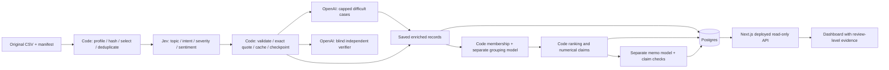

# Spotify review evidence pipeline

An auditable System-1 / System-2 pipeline for deciding where Spotify should direct
product effort, using historical Google Play reviews from May 2022–November 2023.

**The first milestone is a measured 1,000-review learning run.** Scaling to the
210,000-review cohort is a separate decision after inspecting errors, costs, and
throughput. No command silently launches the larger run.

## Current evidence status

This repository contains executable implementation and system tests. Actual paid
pilot results, human-label accuracy, and AI-generated business recommendations are
available only when the corresponding run artifacts exist. See
[implementation status](docs/IMPLEMENTATION_STATUS.md) for limitations.

| Source-data fact | Count |
|---|---:|
| Full original source | 660,622 |
| Nonempty source reviews | 660,609 |
| Empty source texts | 13 |
| Selected nonempty reviews | 210,000 |
| Selected distinct exact texts | 159,657 |
| Exact-text reuse opportunities | 50,343 |
| Learning sample reviews / distinct texts | 1,000 / 926 |

These are source-data counts, not completed classifications. The selected input
includes all 13 empty texts in addition to the 210,000 nonempty reviews.

**Live dashboard:** https://spotify-review-observatory.vercel.app  
The application and API are deployed and publicly accessible. They currently
show an explicit unavailable state because the hosted database and real paid
pilot have not been configured. This is not a completed analysis.

**Validation:** 163 Python tests passed and one optional database integration test
was skipped in the full suite. A separate real PostgreSQL run passed all 14
database tests. The hosted Next.js production build passed compilation and
TypeScript checks. See [validation evidence](validation/README.md).

## Setup

Requires Python 3.11+, Node.js 22+, and `uv` (or equivalent Python environment
management). Dependencies are pinned in `uv.lock` and `web/package-lock.json`.

```sh
uv venv venv
uv pip install --python venv/bin/python --link-mode copy -e '.[dev]'
source venv/bin/activate
cp .env.example .env
spotify-pipeline preflight
```

Populate only the keys used in the ignored `.env`: `TYPESAFE_API_KEY`,
`OPENAI_API_KEY`, and the hosted Postgres `DATABASE_URL`. A separate
`DATABASE_READONLY_URL` is recommended for the deployed dashboard.
Never put these values into browser JavaScript, committed files, or logs.

Download the instructor's
[complete dataset ZIP](https://drive.google.com/file/d/1P0rUoAS_wVjp3BYKqXMEyD4u0uJP1Bvf/view)
and extract all eleven files into `data/source/`. The raw source is intentionally
not committed. Its SHA-256 is
`1fc85de68a304dd8978b537cfa58793d5f41cbaf417fa32cb53899f83a2fcef6`.

```sh
spotify-pipeline prepare
```

Preparation verifies all supplied file checksums, preserves six original field
strings, profiles the complete source, writes a source-ID ledger, and creates
`data/learning_1000.csv` and `data/selected_210000.csv`. Selection uses the course's
seed and SHA-256 ordering. The latter CSV contains 210,013 rows including empties.

The unchanged course contract and zero-API checker are in
[vendor/course](vendor/course/GRADING_CONTRACT.md).

## Human labels

Open [the blind golden-label worksheet](evals/golden-labels.html). A person must
label all 50 reviews before final evaluation; the form does not show predictions.
It saves progress locally and exports labels. Keep the answer file out of prompt
tuning and issue-discovery inputs.

```sh
spotify-pipeline evaluate --gold /path/to/human_labels.csv \
  --records runs/final/records.jsonl --out evals/golden-results \
  --human-labels-confirmed
```

Do not set the confirmation flag for model-generated labels. Verifier agreement
is reported separately and is not human-label accuracy.

## Bounded pilot

Paid execution requires an explicit flag. The pilot includes the real fixed
100-review cold run, its warm replay, 500 reviews, then 1,000 reviews with an
independent model comparison. It uses one shared $1.50 spending ceiling.

```sh
spotify-pipeline pilot --execute-paid --budget 1.50 --workers 4
```

Each stage writes separate artifacts below `runs/pilot/`. The cold run uses one
worker; the warm run reuses saved results and downstream handoffs. Inspect
`learning_report.md`, per-case disagreement evidence, actual costs, and
throughput before further work.

The dedicated pilot cache is `data/pilot_cache.sqlite3`. A cold run rejects a
populated cache. Completed stages are immutable and skipped on restart; partial
stages resume against their original input, configuration, and cache. For a new
configuration experiment, choose a fresh `--out` and `--db`; retain the shared
spending ledger. Do not delete the ledger to reset an experiment's budget.

The pilot stops between stages if classifications, independent verification, or
billed usage remain unresolved. It ends at 1,000; expansion requires inspecting
the learning package and making a separate run decision.

The CLI also accepts an arbitrary six-column input CSV:

```sh
spotify-pipeline run --execute-paid --input /path/to/reviews.csv \
  --out runs/custom --db data/custom.sqlite3 --budget 1.50 \
  --workers 1 --verify-count 10
```

The operational global ceiling is $18, leaving $2 within the total $20 budget.
All attempts, including failures, are logged. A shared ledger reserves estimated
maximum in-flight cost before dispatch. Unknown timeout charges remain visible
and must be reconciled; the ledger does not turn estimates into provider bills.

## Architecture



- **Enrich:** pinned Jev plus bounded OpenAI escalation. Only review text informs
  classification; ratings stay analysis metadata.
- **Verify:** original text and rubric, without first-pass predictions.
- **Group:** stable `issue-<topic>` membership for complaints/cancellations,
  separately prompted issue descriptions from bounded evidence.
- **Memo:** saved ranking, claim IDs, and bounded evidence; code validates
  references and renders checked numerical claims.

Every role has separate prompts, inputs, outputs, and call evidence. Code owns
accounting and arithmetic. Completed or quarantined records preserve original
IDs and source hashes. Direct exact-text reuse never merges business counts.

## Offline reproducibility and calculator

Opening/importing the calculator does not require credentials or make calls.
Prices are editable in [config/rates.csv](config/rates.csv).

```sh
spotify-pipeline replay --calls runs/pilot/100-cold/calls.jsonl \
  --rates config/rates.csv --out cost/replay
spotify-pipeline rerank --run runs/pilot/1000
spotify-pipeline learning-report --pilot runs/pilot
```

The required baseline is `priority_score = severity_sum`, ordered descending
score and ascending issue ID. Each complaint/cancellation contributes once to
one issue. Means use decimal half-up rounding to six places.

The calculator distinguishes actual usage, estimated/missing usage, cached-input
categories, one-time overhead, and measured wall time. Doubling rates must double
only API spend; changing projected volume must not alter pilot measurements.

## Export and check

```sh
spotify-pipeline export --run runs/final --out grading \
  --analysis data/selected_210000.csv
python vendor/course/check_submission.py reference \
  --full data/source/spotify_reviews_18months.csv \
  --analysis data/selected_210000.csv --out data/local-reference.json
python vendor/course/check_submission.py check \
  --reference data/local-reference.json --submission grading \
  --out data/self-check.json
```

The checker supports a declared subset while still checking the full-source
profile. This follows the amended minimum of 100,000 reviews. The README and
dashboard must report the actual selected/classified scope, rather than imply
that all 660,609 nonempty source reviews were classified.

Actual current-run calls and historical cache-origin evidence are separate:
reusing a saved result is not a new billed call. Large grading exports, source
selection artifacts, and run evidence can be distributed as GitHub release
assets with checksums.

## Dashboard deployment

The Next.js app in `web/` exposes database-backed overview, ranking, review
evidence, and saved recommendation APIs. Missing database/results produce an
explicit unavailable state, never sample business figures.

```sh
spotify-pipeline publish-data --run runs/pilot/1000
cd web
npm ci
npm run build
vercel deploy
```

Configure the hosted `DATABASE_READONLY_URL` in Vercel server-side environment
variables. Bulk import uses the local pipeline's writer connection. The public
app makes no model calls and does not offer public write endpoints.

Neon credentials are still required. Local PostgreSQL tests do not establish
Neon storage, sleep/wake behavior, hosted data reconciliation, or final-volume
capacity. Those checks belong to the real deployed pilot.

## Evaluation and rubric map

| Rubric evidence | Location |
|---|---|
| Code, setup, architecture, provenance | This README, `src/`, `prompts/`, `config/` |
| Human golden labels and per-field evaluation | `evals/` after human labeling |
| Independent verification and inspected failures | Run `verification.jsonl`, `disagreements.jsonl`, inspection sheet |
| Cold/warm calculator and editable rates | `cost/`, pilot run folders, `config/rates.csv` |
| Retry, spending, injection, planted-error tests | `tests/`; synthetic tests are explicitly separate |
| Actual interruption/resume | Run checkpoints plus terminal recording after execution |
| Classification and source coverage | `grading/`, source manifests and checker report |
| Deterministic ranking and checked memo | Run membership/ranking/claims/memo |
| Database-backed working dashboard | `web/`, live URL, hosted reconciliation evidence |

```sh
python -m pytest
cd web && npm run build
```

Use `tools/record_command.py` to record a real recovery demonstration. A synthetic
unit test is not a substitute for recording actual saved work and paid-run resume.

```sh
python tools/record_command.py --out runs/recovery.cast -- \
  bash tools/recovery_demo.sh --execute-paid
```

## Interpretation limits

These are self-selected historical app-store reviews, not a random customer
sample. Cancellation language is stated intent, not observed churn. The dataset
has no revenue, verified subscription tier, or causal retention outcomes.
Review-star ratings do not define severity. The first and last calendar months
are partial; any trend comparison must show appropriate denominators.

The analysis asks where product effort should go at the end of the historical
window. Recommendations must remain grounded in saved issue counts, severity,
and traceable review evidence.
