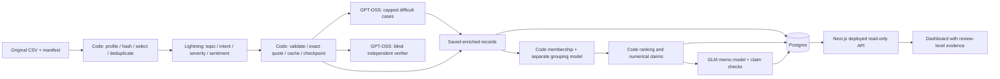

# Spotify review evidence pipeline

An auditable System-1 / System-2 pipeline for deciding where Spotify should direct
product effort, using historical Google Play reviews from May 2022–November 2023.

**The first milestone is a measured 1,000-review learning run.** Scaling to the
210,000-review cohort is a separate decision after inspecting errors, costs, and
throughput. No command silently launches the larger run.

## Current evidence status

The frozen v5 configuration has completed the fixed 100-review cold/warm
measurement, the 500-review checkpoint, and all **1,000 learning reviews with
1,000 independent verifications**. There are no pending or quarantined learning
records. The pilot is published to the database-backed dashboard, and a real
interruption/resume test passed.
Human golden-set accuracy remains unmeasured, and neither the 10,000 nor
210,000 expansion has run. See
[implementation status](docs/IMPLEMENTATION_STATUS.md) for the evidence and gates.

**Decision: fix the observed label errors before expanding.** The
[learning report](docs/learning-report.md) explains the topic/intent/severity
errors, weak uncertainty routing, measured agreement and next development test.
The current business ranking is provisional because incorrect topic assignments
can change which issue ranks first. A separate live synthetic test also exposed
prompt-injection susceptibility in the fast classifier; deterministic flags
caught the suspicious input but did not correct its unsupported labels.

Start with the [learning report](docs/learning-report.md),
[qualitative quality review](docs/learning-quality-review.md),
[scaling economics](docs/scaling-economics.md),
[measured cold/warm calculator](cost/README.md), and
[live synthetic evaluation](evals/synthetic-live/README.md).

Detailed `runs/` artifacts are excluded from Git. The paths below identify files
inside the evidence package. Download and extract the
[v0.1.0-pilot evidence release](https://github.com/shahdevansh/spotify-review-pipeline/releases/tag/v0.1.0-pilot)
to inspect those files. Committed reports summarize the measurements without linking to
nonexistent GitHub run directories.

| Source-data fact | Count |
|---|---:|
| Full original source | 660,622 |
| Nonempty source reviews | 660,609 |
| Empty source texts | 13 |
| Selected nonempty reviews | 210,000 |
| Selected distinct exact texts | 159,657 |
| Exact-text reuse opportunities | 50,343 |
| Learning sample reviews / distinct texts | 1,000 / 926 |

These are source-data counts, not completed classifications. The [ingestion
report](data/ingestion_report.json) records checksum and scope reconciliation.
The selected input
includes all 13 empty texts in addition to the 210,000 nonempty reviews.

**Live dashboard:** [Spotify Review Observatory](https://spotify-review-observatory.vercel.app)

The application and API are public and backed by the published 1,000-review
pilot in Neon. [Hosted reconciliation](validation/pilot_publication.json)
matched all 1,000 database records, eight issue rankings, 32 claims and all
445 issue-membership records across 14 API pages. A subsequent
[observed sleep/wake check](validation/neon_sleep_recovery.json) passed:
the first public overview request returned the 1,000-review result in 1.009 seconds.
[Browser QA](validation/dashboard_visual_qa.json) verified the corrected duplicate
and cache-reuse counts, quality-hold notice and review detail modal.

**Provider adaptation:** the owner supplied Nebius credits. The selected
[v5 configuration](validation/frozen_pilot_configuration.json) uses
`nvidia/Nemotron-3_5-Lightning` without thinking for initial classification,
`openai/gpt-oss-120b` at low reasoning effort for fallback, independent
verification and grouping, and `zai-org/GLM-5.3-Flash` at low effort for the memo.
Nebius hosts all these calls. This implements fast and deliberative model roles;
Lightning is not Jev and its review flags are not calibrated confidence.
The original Jev/OpenAI adapters remain available. See
[model selection, failures, and measured probes](docs/nebius-adaptation.md).

The fixed-100 cold run completed eight model requests in **39.803 seconds** at
**$0.00654034** of nominal token value. Its identical warm replay completed in
**0.0785 seconds with zero new requests and zero incremental API value**.
Cold evidence (`runs/pilot/100-cold/run_summary.json`) and
warm evidence (`runs/pilot/100-warm/run_summary.json`) include all pipeline stages.
These amounts price reported usage; provider credit debits and new cash expense
have not been reconciled.

The complete cold/warm/500/1,000 sequence used **156 requests, no failed
attempts, $0.118772214 of nominal API value, and 448.697 seconds of active wall
time**. Later checkpoints reused prior outputs; their timings are incremental.
The final 1,000 records represent 926 distinct texts, with 74 exact-text aliases,
46 fallback classifications and 60 `needs_review` flags.

Independent final-label agreement was **82.8% topic, 90.6% intent and 83.8%
severity**; severity mean absolute difference was 0.201. These compare model
predictions, not human answers. The learning report keeps expansion gated while
the observed label errors and routing weaknesses are addressed.

The current full Python suite has **247 passed and one optional integration
test skipped**. Software, database and public-interface checks are listed in
[validation evidence](validation/README.md). Automated tests establish software
behavior, not human-label accuracy.

The unchanged course checker returns `review_required` for both the main pilot
and separate recovery evidence. The main run has no interruption/resume
checkpoint. Recovery preserves unknown usage for the deliberately cancelled
call, and later scheduled fallback requests touch three checkpoint IDs. The
recovery helper confirms no lost IDs or repeated **first-pass** classification;
it does not claim that every later paid call excludes previously completed IDs.
See [validation details](validation/README.md).

## Setup

Requires Python 3.11+, Node.js 22+, and `uv` (or equivalent Python environment
management). Dependencies are pinned in `uv.lock` and `web/package-lock.json`.

```sh
uv venv venv
uv pip install --python venv/bin/python --link-mode copy -e '.[dev]'
source venv/bin/activate
cp .env.example .env
spotify-pipeline preflight
```

Populate only the keys used in the ignored `.env`: `NEBIUS_API_KEY` for the
Nebius configuration, or TypeSafe/Vercel Gateway and OpenAI keys for the
original configuration. The hosted Postgres uses `DATABASE_URL`. A separate
`DATABASE_READONLY_URL` is recommended for the deployed dashboard.
Never put these values into browser JavaScript, committed files, or logs.

Download the instructor's
[complete dataset ZIP](https://drive.google.com/file/d/1P0rUoAS_wVjp3BYKqXMEyD4u0uJP1Bvf/view)
and extract all eleven files into `data/source/`. The raw source is intentionally
not committed. Its SHA-256 is
`1fc85de68a304dd8978b537cfa58793d5f41cbaf417fa32cb53899f83a2fcef6`.

```sh
spotify-pipeline prepare
```

Preparation verifies all supplied file checksums, preserves six original field
strings, profiles the complete source, writes a source-ID ledger, and creates
`data/learning_1000.csv` and `data/selected_210000.csv`. Selection uses the course's
seed and SHA-256 ordering. The latter CSV contains 210,013 rows including empties.

The unchanged course contract and zero-API checker are in
[vendor/course](vendor/course/GRADING_CONTRACT.md).

## Human labels

Open [the blind golden-label worksheet](evals/golden-labels.html). A person must
label all 50 reviews before final evaluation; the form does not show predictions.
It saves progress locally and exports labels. Keep the answer file out of prompt
tuning and issue-discovery inputs.

```sh
spotify-pipeline evaluate --gold /path/to/human_labels.csv \
  --records runs/final/records.jsonl --out evals/golden-results \
  --human-labels-confirmed
```

Do not set the confirmation flag for model-generated labels. Verifier agreement
is reported separately and is not human-label accuracy.

## Bounded pilot

Paid execution requires an explicit flag. The pilot includes the real fixed
100-review cold run, its warm replay, 500 reviews, then 1,000 reviews with an
independent model comparison. It uses one shared $1.50 spending ceiling.

```sh
spotify-pipeline pilot --config config/nebius-pilot.json \
  --execute-paid --budget 1.50 --workers 4 \
  --out runs/my-pilot --db data/my-pilot-cache.sqlite3
```

Each stage writes separate artifacts below the chosen output directory. The cold run uses one
worker; the warm run reuses saved results and downstream handoffs. Inspect
`learning_report.md`, per-case disagreement evidence, actual costs, and
throughput before further work.

The recorded v5 pilot uses `data/pilot_v5_cache.sqlite3`; the CLI default is
`data/pilot_cache.sqlite3`. A cold run rejects a
populated cache. Completed stages are immutable and skipped on restart; partial
stages resume against their original input, configuration, and cache. For a new
configuration experiment, choose a fresh `--out` and `--db`; retain the shared
spending ledger. Do not delete the ledger to reset an experiment's budget.

The pilot stops between stages if classifications, independent verification, or
billed usage remain unresolved. It ends at 1,000; expansion requires inspecting
the learning package and making a separate run decision.

The CLI also accepts an arbitrary six-column input CSV:

```sh
spotify-pipeline run --execute-paid --input /path/to/reviews.csv \
  --config config/nebius-pilot.json \
  --out runs/custom --db data/custom.sqlite3 --budget 1.50 \
  --workers 1 --verify-count 10
```

The operational global ceiling is $18, leaving $2 within the total $20 budget.
All attempts, including failures, are logged. A shared ledger reserves estimated
maximum in-flight cost before dispatch. Unknown timeout charges remain visible
and must be reconciled; the ledger does not turn estimates into provider bills.

## Architecture



- **Enrich:** Lightning with GPT-OSS fallback capped at five percent of distinct
  texts. Only original review text informs classification; ratings stay
  analysis metadata. Requests contain at most 25 reviews.
- **Verify:** original text and rubric, without first-pass predictions.
  GPT-OSS fallback and verification use batches of at most ten. Because the
  fallback and verifier share a model, their agreement must be interpreted
  separately from first-pass agreement.
- **Group:** stable `issue-<topic>` membership for complaints/cancellations,
  separately prompted issue descriptions from bounded evidence.
- **Memo:** GLM receives saved ranking, claim IDs, and bounded evidence. Dynamic
  schemas restrict allowed identifiers and numeral-free prose; code checks
  cross-issue references and renders numerical claims. Semantic review remains
  necessary even when structural checks pass.

Every role has separate prompts, inputs, outputs, and call evidence. Code owns
accounting and arithmetic. Completed or quarantined records preserve original
IDs and source hashes. Direct exact-text reuse never merges business counts.

## Offline reproducibility and calculator

Opening/importing the calculator does not require credentials or make calls.
Prices are editable in [config/rates.csv](config/rates.csv).

```sh
spotify-pipeline replay --calls runs/pilot/100-cold/calls.jsonl \
  --rates config/rates.csv --out cost/replay
spotify-pipeline rerank --run runs/pilot/1000
spotify-pipeline learning-report --pilot runs/pilot
```

The required baseline is `priority_score = severity_sum`, ordered descending
score and ascending issue ID. Each complaint/cancellation contributes once to
one issue. Means use decimal half-up rounding to six places.

The calculator distinguishes reported usage, estimated/missing usage, cached-input
categories, one-time overhead, and measured wall time. Doubling rates must double
only API spend; changing projected volume must not alter pilot measurements.

## Export and check

```sh
spotify-pipeline export --run runs/final --out grading \
  --analysis data/selected_210000.csv
python vendor/course/check_submission.py reference \
  --full data/source/spotify_reviews_18months.csv \
  --analysis data/selected_210000.csv --out data/local-reference.json
python vendor/course/check_submission.py check \
  --reference data/local-reference.json --submission grading \
  --out data/self-check.json
```

The checker supports a declared subset while still checking the full-source
profile. This follows the amended minimum of 100,000 reviews. The README and
dashboard must report the actual selected/classified scope, rather than imply
that all 660,609 nonempty source reviews were classified.

Actual current-run calls and historical cache-origin evidence are separate:
reusing a saved result is not a new billed call. Large grading exports, source
selection artifacts, and run evidence can be distributed as GitHub release
assets with checksums.

## Dashboard deployment

The Next.js app in `web/` exposes database-backed overview, ranking, review
evidence, and saved recommendation APIs. Missing database/results produce an
explicit unavailable state, never sample business figures.

```sh
spotify-pipeline publish-data --run runs/pilot/1000
cd web
npm ci
npm run build
vercel deploy
```

Configure the hosted `DATABASE_READONLY_URL` in Vercel server-side environment
variables. Bulk import uses the local pipeline's writer connection. The public
app makes no model calls and does not offer public write endpoints.

The application is connected to Neon with a dedicated read-only role. A fresh
deployment needs its own credentials. Local PostgreSQL tests do not establish
final-volume capacity. Hosted reconciliation and observed sleep/wake recovery
are saved for the 1,000-review pilot. Its application tables occupy 1,425,408 bytes;
a simple 210,000-review projection is 299,335,680 bytes, below the 700 MB gate,
but that projection must be refreshed at the 10,000-review checkpoint.

## Evaluation and rubric map

| Rubric evidence | Location |
|---|---|
| Code, setup, architecture, provenance | This README, `src/`, `prompts/`, `config/` |
| Human golden labels and per-field evaluation | `evals/` after human labeling |
| Independent verification and inspected failures | Run `verification.jsonl`, `disagreements.jsonl`, inspection sheet |
| Cold/warm calculator and editable rates | `cost/`, pilot run folders, `config/rates.csv` |
| Retry, spending, injection, planted-error tests | `tests/`; synthetic tests are explicitly separate |
| Actual interruption/resume | Run checkpoints plus terminal recording after execution |
| Classification and source coverage | `grading/`, source manifests and checker report |
| Deterministic ranking and checked memo | Run membership/ranking/claims/memo |
| Database-backed working dashboard | `web/`, live URL, hosted reconciliation evidence |

```sh
python -m pytest
cd web && npm run build
```

Use `tools/record_command.py` to record a real recovery demonstration. A synthetic
unit test is not a substitute for recording actual saved work and paid-run resume.

```sh
python tools/record_command.py --out runs/recovery.cast -- \
  bash tools/recovery_demo.sh --execute-paid
```

## Interpretation limits

These are self-selected historical app-store reviews, not a random customer
sample. Cancellation language is stated intent, not observed churn. The dataset
has no revenue, verified subscription tier, or causal retention outcomes.
Review-star ratings do not define severity. The first and last calendar months
are partial; any trend comparison must show appropriate denominators.

The analysis asks where product effort should go at the end of the historical
window. Recommendations must remain grounded in saved issue counts, severity,
and traceable review evidence.
