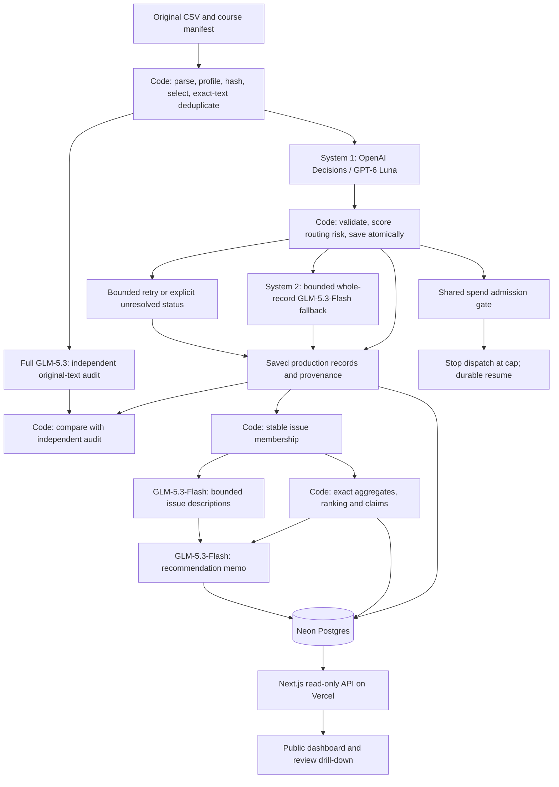

# What 200,000 Spotify reviews suggest we should fix next

**[Open the live dashboard →](https://spotify-review-observatory.vercel.app/)**

Explore the product priorities, results from 200,000 reviews, and original review evidence. Public access; no sign-in or API key required.

## Summary

I recommend prioritizing **easier everyday listening controls**, followed by **more reliable playback** and **clearer Premium access and billing**. Usability leads the analysis with 25,563 complaint or cancellation reviews and a combined severity score of 68,258. Playback problems appear in 12,548 reviews and are more severe on average, while 12,794 billing reviews point to confusion about paid features, missing benefits, and unwanted charges. Together, these three areas account for 50,905 review reports and give Spotify a focused starting point for product improvements.

This project turns historical Spotify app-store reviews into a product recommendation that can be followed back to individual reviews. It ingested the entire 660,622-row source, classified a reproducible subset of **200,000 nonempty reviews**, and independently checked **40,000 reviews** with a separate verifier. Saved predictions connect to review evidence, reproducible rankings, a recommendation memo, and a public database-backed dashboard.

The recommended first steps are to make song selection and library controls more predictable, fix interruptions during common listening sessions, and make payment, feature access, and cancellation status easier to resolve. The review examples below explain those problems, while the evaluation section shows how reliably the pipeline classified them.

The [live dashboard](https://spotify-review-observatory.vercel.app) is the easiest way to explore the results, while the [decision memo](docs/hero-decision-memo.md) explains the proposed actions and alternatives. For grading, [SUBMISSION.md](SUBMISSION.md) connects the assignment requirements to the code and saved evidence.

<a id="results-and-scope"></a>

## Results from the hero run

The final large run, called `hero-v1`, completed all 200,000 selected nonempty reviews and separately quarantined the source's 13 empty texts, leaving no selected records pending execution. This exceeds the amended assignment minimum of 100,000 classified reviews; the remaining source reviews were profiled but were outside the classification scope.

| Measure | Final result |
|---|---:|
| Full source profiled | 660,622 reviews |
| Nonempty reviews classified | 200,000 |
| Empty texts quarantined / records pending execution | 13 / 0 |
| Distinct review texts / exact-text reuse | 152,363 / 47,637 |
| Independently verified original reviews | 40,000, or 20% of the run |
| Topic / intent agreement with the verifier | 90.4675% / 93.0500% |
| Reviews with a topic, intent, or severity disagreement | 8,565 of 40,000 |
| Topic / intent agreement on the golden review set | 72% / 88% |
| Severity agreement / sentiment MAE on the golden review set | 80% / 0.1974 |
| Recorded project usage at the completed hero snapshot | $35.32, plus a $1.56 uncertain-charge hold |
| Measured workflow through the first public release | Approximately 4 hours 10 minutes |

The cost snapshot includes earlier experiments as well as the hero workflow and fits within the $50 project budget. It prices recorded provider usage and reserves an allowance for requests whose charges could not be established, rather than claiming an invoice reconciliation. A later, separate synthetic check of the frozen configuration cost another $0.0055. The runtime includes checkpoints, recovery, the final audit, and first publication; classification during scaling took approximately 2 hours 59 minutes, and subsequent documentation and review are outside that timing boundary. Exact scopes and accounting appear in the [reproduction guide](docs/hero-reproduction-and-evidence.md).

<a id="recommendation-and-evidence-trail"></a>

## Recommendation and product insights

The ranking contains 87,897 complaint or cancellation reviews, grouped into eight primary topics. Each issue's score is the sum of its reviews' severity values, so the ranking reflects both frequency and functional impact. Scores sort in descending order, with ascending issue ID breaking ties, and means use decimal half-up rounding to six places. Usability leads with a score of 68,258, ahead of the broad `other` category at 51,774, playback at 39,445, and billing at 35,437.

Usability's lead is not a claim that it has the most complaints. The `other` category contains 25,992 eligible reviews, slightly more than usability's 25,563. Usability wins because the assigned severity values contribute more to the required ranking. This distinction mattered during the editorial review, which caught and corrected an incorrect volume claim in the generated memo.

The usability examples describe unwanted shuffle behavior, difficulty finding music, accidental playlist changes, and lost saved content. They support simplifying everyday listening controls and adding recovery for accidental changes. Playback examples describe songs stopping in the background, crashes, and failed speaker connections. Billing examples cover expectations about free and paid features, paid benefits that are unavailable, and charges after cancellation. The [decision memo](docs/hero-decision-memo.md) gives concrete actions and original review examples for each area. Topic totals measure the broad areas; individual symptoms have not been counted separately.

Playback has an average severity of 3.14 out of 5, compared with 2.67 for usability and 2.77 for billing. Account access has the highest average severity at 3.77, but a smaller count of 2,917. That makes access recovery a useful targeted workstream alongside the three larger product priorities. The complete ranking and its exact values remain available in the saved evidence.

These are historical, self-selected app-store reviews, and cancellation language records expressed intent rather than observed churn. The [memo](docs/hero-decision-memo.md) connects each material number to a saved claim and gives review IDs for its examples, so the recommendation can be challenged without rerunning a model.

<a id="what-improved-after-the-pilot"></a>

## Experiments that shaped the final run

The project began with small checkpoints and a 1,000-review learning run before expanding. The development comparison used the same 200 full GLM-5.3 reference judgments for each candidate, allowing differences in routing to be examined on matched records.

| Configuration | Topic agreement | Intent agreement |
|---|---:|---:|
| Earlier Lightning configuration | 78.0% | 89.5% |
| Earlier Decisions configuration | 89.5% | 92.5% |
| Initial hero configuration with 5% fallback | 89.0% | 93.0% |
| Selected configuration with 15% fallback | 91.0% | 93.5% |
| Fresh 1,000-review confirmation, with 200 audited | 94.0% | 93.5% |
| Final hero run, with 40,000 audited | 90.4675% | 93.0500% |

The selected routing configuration increased whole-record fallback from 5% to 15%, broadened uncertainty eligibility, and weighted topic, intent, and severity confidence when choosing records to escalate. Together, these changes improved the matched development result by two percentage points for topic and half a point for intent. The fresh confirmation and hero rows use different samples, so their differences should be interpreted as evidence about generalization rather than matched improvements.

The fixed 100-review cold run cost $0.02360475 across 105 attempts and took 41.9034 seconds. Repeating the identical run with saved outputs made zero calls, cost $0, and took 0.2137 seconds. Offline calculator checks established that changing projected volume leaves those measurements intact, while doubling API rates doubles the API subtotal. The [pilot report](evals/hero-pilot/report.md) preserves the comparisons and uncertainty estimates.

Operational experiments were equally consequential. Enrichment was increased to 32 workers only after a load observation achieved 31.79 requests per second without failures. During the final audit, provider latency rose and requests began timing out; the harness preserved completed work, recorded uncertain charges, and resumed with a tested 180-second timeout. The actual final audit used eight workers and completed all 40,000 comparisons. This recovery demonstrated why durable checkpoints and bounded spending matter even when the model configuration has already been frozen.

## What the evaluation tells us

The large audit met the requested topic and intent agreement targets as point estimates, but those figures describe agreement between models. The verifier saw original text and the rubric without production answers, although its model family was also used for fallback. Its errors can therefore be correlated with the production system's errors. Intent's 95% interval spans 92.7966% to 93.2951%, which also leaves uncertainty about whether population agreement exceeds 93%.

The golden review set provides a more demanding comparison with the reviewed reference: topic matched on 36 of 50 reviews, intent on 44, and severity on 40, while sentiment mean absolute error was 0.1974. All four required fields are now complete. The [public comparison](evals/human-reference-v3/) includes all 200 worksheet records and a separate golden-50 view; only the 99 worksheet IDs present in the hero cohort have production predictions, and additional field denominators reflect incomplete annotations.

The reference was finalized after earlier model comparisons, including 43 approved topic adjudications. Its last 51 missing fields were completed from model-generated suggestions that the project author reviewed and confirmed, changing five suggestions. These methods are retained in the versioned provenance, and the reference scores should be interpreted as posthoc agreement rather than a blind estimate of population accuracy. Human labels were used only for offline evaluation, and completing the reference changed no production predictions.

The most actionable weakness is confidence calibration. In one inspected review, a complaint about ads and Premium-only shuffle received a usability label with 0.99 topic confidence and no review flag, while the independent verifier identified billing. Across the golden set, `needs_review` caught only five of the 17 topic or intent disagreements, even though 51,293 of the full 200,000 records remain flagged. This combination of missed disagreements and a substantial review workload supports recalibrating the routing policy while retaining a random audit.

One review demonstrates the full evidence path. Review `07f60ec3-2a42-4903-862a-4de5265803d6` describes song-selection restrictions and alleged playlist or account deletion. Enrichment assigned usability, complaint, and severity 5, with a review flag; the independent verifier assigned playback, complaint, and severity 4. Its frozen membership in `issue-usability` contributes one review and five severity points to the ranking, and the memo cites it alongside `claim-usability-complaint-count` and `claim-usability-severity-sum`. The disagreement remains recorded because the text does not establish the cause or permanence of the reported loss, and verification never replaced the production label.

The audit also found that numerical consistency and interpretation quality require different checks. An independent implementation reproduced the saved membership, ranking, and claims byte for byte, while the narrative review still had to correct an unsupported superlative and overly specific issue descriptions. Keeping calculations separate from generated prose made those corrections possible without changing the underlying results.

<a id="architecture-and-frozen-model-roles"></a>

## How the harness works

The pipeline assigns different jobs to models and deterministic code. Python profiles the source, preserves row identities, selects the cohort, and finds exact duplicate texts. OpenAI Decisions with `gpt-6-luna` supplies the System 1 first pass, and Nebius GLM-5.3-Flash provides System 2 whole-record fallback for up to 15% of distinct texts. Full GLM-5.3 independently verifies the seeded audit sample. Separate prompted roles describe issues and draft recommendations from bounded evidence, while code determines membership, computes rankings, and validates numerical claims.



The weighted routing score combines topic, intent, and severity confidence at 0.5, 0.4, and 0.1, supplemented by contradiction rules. It is a prioritization score rather than a calibrated probability of error. Classification inputs contain review text without star ratings or other metadata, and request sizes stay within the assignment's 50-review limit. The Decisions pass uses one review per request.

Every completed request saves validated results and provenance atomically. Cache identity includes the model, prompts, schema, and routing configuration, while duplicate texts retain separate original-review counts through direct links to completed records. A shared ledger includes spending, in-flight reservations, and uncertain charges before admitting more work. Compression, indexed admission, and recovery from offloaded local files improved reliability without altering the frozen classification configuration.

The dashboard runs on Next.js and Vercel with Neon Postgres, so viewing a review or recommendation makes no model call. Its 200,013 stored records and eight issues occupy approximately 269 MB. Public API reconciliation checked all 87,897 issue members, every issue ranking, all 32 numerical claims, and sampled original-review details against saved outputs. Synthetic and recovery evidence separately tests malformed output, retries, spending, injection, planted errors, and interruption.

## Improvements to make next

The next version should begin with a fresh, independently labeled development and evaluation sample, concentrating its development work on the boundaries among usability, billing, playback, and generic criticism. The completed golden set identifies weaknesses, but repeatedly tuning against it would make future scores progressively less informative. Severity and sentiment also need clearer examples at their boundaries, especially where generic dissatisfaction differs from a specific functional failure.

Routing should then be evaluated by how many real errors it catches at each escalation budget, rather than by provider confidence alone. The confident billing error suggests adding targeted consistency checks, while preserving a random audit to catch mistakes outside those rules. Any revised routing policy should be frozen and tested on fresh records before another large run.

Finally, a finer issue taxonomy would make the product recommendation more specific. That requires saved subtopic membership and new prevalence calculations before describing library loss or confusing controls as separately ranked problems. Generated recommendations should continue to obtain all numerical claims from checked aggregates, with examples used to explain the experience rather than to establish its frequency.

<a id="setup-and-source-data"></a>
<a id="inspect-and-reproduce-the-final-evidence-without-api-calls"></a>

## Reproduce the results

The Python environment is pinned in [uv.lock](uv.lock), and the web dependencies are pinned in [web/package-lock.json](web/package-lock.json). A fresh installation was verified with CPython 3.13.11; the project requires Python 3.11 or later and Node.js 22 or later for the dashboard.

```sh
uv sync --frozen --extra dev --link-mode copy
source .venv/bin/activate
```

The instructor's [source dataset ZIP](https://drive.google.com/file/d/1P0rUoAS_wVjp3BYKqXMEyD4u0uJP1Bvf/view) contains the historical May 2022 to November 2023 review extract. The complete source CSV has SHA-256 `1fc85de68a304dd8978b537cfa58793d5f41cbaf417fa32cb53899f83a2fcef6`; the guide below explains how to regenerate the selected cohort from it.

Download the [hero evidence release](https://github.com/shahdevansh/spotify-review-pipeline/releases/tag/hero-v1) to inspect results without credentials. The [reproduction and evidence guide](docs/hero-reproduction-and-evidence.md) gives the exact source checksum, cohort regeneration, calculator replay, offline reranking, checker commands, and deployment procedure. The [calculator guide](cost/hero-replay.md) explains the explicit hero settings, and [HERO_RUN.md](HERO_RUN.md) describes paid execution and recovery.

## Evidence and submission

The [submission guide](SUBMISSION.md) maps the rubric to the release, current reference comparison, recovery recording, and working dashboard. The original hero release and subsequent evaluation supplements are preserved separately, allowing a reader to distinguish inference results from later reference completion and documentation.

The supplied course checker reports `review_required` because 48 failed requests have no reported token usage, producing 96 missing usage fields; its other checks pass. Those failures remain visible, their usage is not replaced with invented zeros, and the uncertain-charge hold remains in accounting. The [technical guide](docs/hero-reproduction-and-evidence.md) explains the separate publication gate and links the unchanged checker evidence. The public repository is the course submission artifact, and publication itself does not submit the course form.
